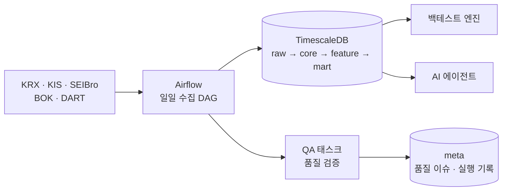

# Quant-Agent Data Pipeline

**자연어 투자 전략을 10년치 실제 데이터로 백테스트하는 서비스, [Quant Agent](https://github.com/sj0618/Quant_agent)의 데이터 엔지니어링 파트입니다.**

한이음 공모전 팀 프로젝트에서 데이터 파이프라인을 맡아, 5개 원천의 금융 데이터를 매일 자동으로 수집·정규화하고 백테스트 엔진과 AI 에이전트가 바로 쓰는 조회용 테이블까지 만들었습니다.

> 이 저장소는 팀 프로젝트 중 데이터 엔지니어링 파트를 정리한 것입니다. 2026년 8월 이후 작업은 [팀 레포](https://github.com/sj0618/Quant_agent)의 `DE/` 폴더에서 이어집니다.

---

## 한눈에 보기

| 항목 | 내용 |
|---|---|
| 담당 | 데이터 수집·적재 파이프라인, DB 스키마, 데이터 품질 검증, 기술 지표 계산 |
| 데이터 원천 | KRX, 한국투자증권(KIS) Open API, SEIBro, 한국은행(BOK), DART |
| 적재 규모 | 수정주가 일봉 약 640만 건, 거시 지표 30,825건, 분기 재무 73,342건 |
| 기술 지표 | 정의 158개, 백테스트 기본 선계산 45개 key |
| 스택 | Python, Apache Airflow, PostgreSQL · TimescaleDB, TA-Lib, Docker |

---

## 전체 서비스에서의 위치



이 저장소가 담당하는 범위는 원천 데이터 수집부터 `mart` 조회 계층까지입니다. 백테스트 엔진과 AI 에이전트는 `mart` view를 통해 데이터를 읽습니다.

---

## 파이프라인 구조

### 일일 수집 DAG (`quant_agent_daily_data_engineering`)

```text
ingest_ohlcv_daily (KRX 원주가)
  ├─ refresh_symbol_metadata_daily ─┬─ ingest_dart_financials_daily
  │                                 └─ run_data_quality_checks_daily
  ├─ ingest_kis_adjusted_ohlcv_daily (KIS 수정주가)
  │     └─ compute_ta_indicators_daily (기술 지표)
  │           └─ run_data_quality_checks_daily
  └─ ingest_bok_daily (거시 지표)
```

- 모든 태스크는 Airflow의 `logical_date`를 기준으로 대상 거래일을 계산합니다. 실행 시점의 "오늘"에 의존하지 않기 때문에 과거 날짜를 다시 돌려도 같은 결과가 나옵니다.
- 태스크 사이에는 실행 ID와 적재 건수 같은 가벼운 결과만 주고받고, 실제 데이터는 DB를 통해 읽습니다.
- 외부 API 실패에 대비해 태스크마다 재시도를 설정했습니다.
- 지표 계산은 CPU 연산이 많아 `ProcessPoolExecutor`로 종목별 병렬 처리합니다.

이 밖에 누락 구간을 다시 채우는 `quant_agent_ohlcv_repair`, 10년치 초기 적재용 `quant_agent_backfill_ohlcv_10y` DAG가 있습니다.

### 데이터 계층

| 계층 | 역할 | 대표 테이블 |
|---|---|---|
| `raw` | 원본 응답 보존 (재처리·장애 분석용) | `raw.ohlcv_response`, `raw.dart_response` |
| `core` | 종목·거래일·원주가 기준 데이터 | `core.symbol_master`, `core.trading_calendar`, `core.ohlcv_daily` |
| `feature` | 수정주가, 기술 지표, 거시·재무 데이터 | `feature.adjusted_ohlcv_daily`, `feature.ta_*_ticker_daily` |
| `mart` | 백테스트·서비스가 바로 읽는 view | `mart.kis_adjusted_feature_frame_asof` |
| `meta` | 실행 기록, API 요청 로그, 품질 이슈, lineage | `meta.ingestion_run`, `meta.data_quality_issue` |

시계열 테이블은 TimescaleDB 하이퍼테이블로 만들었고, 기술 지표는 추세·모멘텀·변동성·거래량·패턴 5개 테이블로 나눠 필요한 지표만 조회할 수 있게 했습니다.

---

## 데이터 품질 검증

수집이 "성공"으로 끝나도 데이터가 비어 있을 수 있기 때문에, DAG 마지막에 QA 태스크를 두고 결과를 `meta.data_quality_issue`에 기록합니다.

| 검사 | 내용 |
|---|---|
| 누락 거래일 | 거래일 캘린더 대비 종목별로 빠진 날짜 탐지 |
| 필수 필드 | 시가·고가·저가·종가 Null, 0 이하 가격, OHLC 순서 오류 |
| 중복 | 같은 종목·날짜 키의 중복 행 |
| 멈춘 가격 | 여러 거래일 동안 가격이 그대로인 구간 |
| 거래량 이상치 | 거래량 급변, 0 거래량 지속 |
| KIS ↔ KRX 정합성 | 수정주가와 원주가 사이의 비정상 괴리·결측 |

KIS API는 요청 1건 단위로 상태 코드, 재시도 횟수, 지연 시간을 `meta.api_request_log`에 남겨 장애 원인을 추적할 수 있게 했습니다.

---

## 트러블슈팅

### 1. 성공으로 표시됐지만 0건이었던 수집

- **문제:** 새벽에 도는 수집 태스크가 Airflow에서 초록색 성공으로 끝났지만, 로그를 보니 수집된 데이터가 0건이었습니다.
- **원인:** KIS API 공식 FAQ를 확인해 보니 당일 시세는 다음 날 오전 8시에 갱신됩니다. 데이터가 준비되기 전에 요청을 보내고 있었습니다.
- **해결:** 실행 시각을 갱신 이후로 옮겼고(최종 10:00 KST, 팀 레포 `a26a125`), 빈 데이터가 성공 뒤에 묻히지 않도록 QA 태스크의 검증을 보강했습니다.

### 2. 크론 타임존 오류로 DAG 파싱 실패

- **문제:** 한국 시간으로 돌리려고 크론식 앞에 `CRON_TZ=Asia/Seoul`을 붙이자 `AirflowTimetableInvalid` 오류가 나며 스케줄이 동작하지 않았습니다.
- **원인:** Airflow는 크론식 안의 타임존 지정을 해석하지 못하고, 기본적으로 UTC를 기준으로 스케줄을 계산합니다.
- **해결:** 크론식에서 `CRON_TZ`를 빼고, `pendulum`으로 만든 `Asia/Seoul` 타임존을 `start_date`에 주입해 DAG 단위로 한국 시간을 적용했습니다. (`0dd734f`)

### 3. Backfill 때 과거 날짜에 오늘 데이터가 덮어써짐

- **문제:** 과거 구간을 다시 채우자 과거 날짜 자리에 실행 당일 데이터가 들어갔습니다.
- **원인:** 수집 대상 날짜를 실행 시점의 현재 날짜로 계산하고 있었습니다.
- **해결:** Airflow가 넘겨주는 `logical_date`로 대상 날짜를 계산하도록 바꿔, 언제 몇 번을 재실행해도 같은 결과가 나오도록 멱등성을 확보했습니다.

### 4. 하이퍼테이블 서버 이관 시 데이터 누락 위험

- **문제:** 로컬 DB를 서버로 옮길 때 일반 `pg_dump` 방식으로는 하이퍼테이블 데이터가 제대로 옮겨지지 않았습니다.
- **해결:** `COPY (SELECT ...) TO STDOUT`을 서버 `psql`로 바로 파이프하는 스트리밍 방식으로 바꾸고, 이관 후 테이블별 건수를 대조해 수정주가 일봉 6,409,656건이 빠짐없이 옮겨진 것을 확인했습니다.

---

## 실행 방법

```powershell
# 1) DB 비밀번호를 현재 세션에만 주입 (저장소에 커밋하지 않음)
$env:QUANT_DB_PASSWORD = "<your-local-password>"

# 2) TimescaleDB 컨테이너 실행 + migrations 순서대로 적용
.\scripts\apply_migrations.ps1

# 3) Python 환경
python -m venv .venv
.\.venv\Scripts\python.exe -m pip install -r requirements.txt

# 4) 품질 검증 실행 예시
.\.venv\Scripts\python.exe .\scripts\run_data_quality_checks.py --start-date 2026-07-01 --end-date 2026-07-09 --checks all

# 5) 테스트
.\.venv\Scripts\python.exe -m pytest -q tests
```

자세한 내용은 아래 문서에 있습니다.

- [로컬 DB 구성](docs/local_db_setup.md)
- [수집 스크립트 설명](docs/data_engineering_ingestion_scripts.md)
- [운영 런북](docs/data_engineering_runbook.md)
- [서버 DB 테이블 현황](docs/public_server_db_tables.md)
